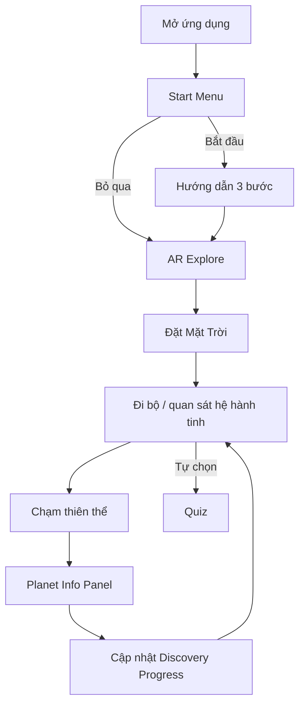

# Phạm vi và luồng người dùng – Trần Huy Hoàng (Tuần 1–4)

## Mục tiêu MVP

- Người học mở ứng dụng, xem hướng dẫn ngắn và bắt đầu trải nghiệm AR.
- Người học nhìn thấy Mặt Trời và 8 hành tinh dưới dạng prefab nhẹ, có nhãn dễ đọc.
- Chạm vào một thiên thể để xem dữ liệu khoa học đã chuẩn hóa.
- Theo dõi số thiên thể đã khám phá; quiz là phần bổ sung và không chặn luồng AR chính.

## Luồng chính



## Tiêu chí chấp nhận

1. Có đúng 9 `PlanetData` và 9 prefab: Sun, Mercury, Venus, Earth, Mars, Jupiter, Saturn, Uranus, Neptune.
2. Mỗi prefab dùng primitive và material nội bộ, không phụ thuộc asset không rõ giấy phép.
3. Panel hiển thị tên, mô tả, AU, bán kính, chu kỳ quỹ đạo, chu kỳ tự quay, số vệ tinh và trạng thái vành đai.
4. Menu và hướng dẫn dùng nút tối thiểu 48 px; nội dung tiếng Việt; tương phản cao.
5. Nhãn 3D luôn quay về camera.
6. Quiz và discovery progress có thể chạy độc lập với module GPS/scale.

## Wireframe mức thấp

```text
┌──────────────────────────────┐
│        SOLAR SYSTEM AR       │
│  Khám phá theo đúng tỉ lệ    │
│                              │
│       [ BẮT ĐẦU ]            │
│       [ BỎ QUA ]             │
└──────────────────────────────┘

┌──────────────────────────────┐
│ [Đã khám phá 3/9 ━━━━━---]   │
│                              │
│        camera / AR           │
│            ● Sao Hỏa         │
│                              │
│ ┌──────────────────────────┐ │
│ │ Sao Hỏa              [×] │ │
│ │ mô tả + số liệu khoa học │ │
│ └──────────────────────────┘ │
└──────────────────────────────┘
```

## Quyết định UI

- Màu nền xanh đen `#071426`, accent cyan `#35D0FF`, chữ trắng.
- Panel neo mép dưới để không che tâm màn hình AR.
- Dữ liệu dài được chia thành mô tả và nhóm facts; không dùng đoạn văn đặc.
- Prototype có scene riêng `HoangFeatureDemo` để nghiệm thu UI mà không làm thay đổi scene AR của thành viên khác.
